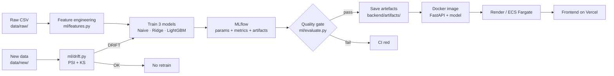

# StockSense — Demand Forecasting & MLOps

> End-to-end, portfolio-grade demand forecasting and inventory monitoring with a
> production-flavoured MLOps pipeline: LightGBM quantile forecasting, SHAP
> explainability, PSI/KS drift monitoring, MLflow experiment tracking,
> Dockerised FastAPI, GitHub Actions CI/CD, weekly auto-retrain, and
> Render + Vercel (free) + AWS/Terraform deployment paths.

**Author:** Atharva Kshirsagar

---

## 1. Problem

Retailers need accurate short-horizon demand forecasts for every store-item pair so they can
optimise inventory — enough stock to meet demand at a target service level, but not so much
that cash is tied up in excess inventory. We solve two coupled problems:

1. Forecast daily sales for every `(store, item)` pair 28 days ahead, with prediction
   intervals.
2. Translate those forecasts into actionable inventory decisions: safety stock, reorder
   points, and order quantities under user-chosen lead time + service level.

## 2. Dataset

Public **Store Item Demand Forecasting** dataset (Kaggle competition data mirrored on
GitHub) — daily sales for 10 stores × 50 items from 2013-01-01 to 2017-12-31.

To keep the repo compact we commit a **subset**: all 10 stores × the first 10 items —
182,600 rows in `data/raw/train.csv`.  The last **60 days** are copied to `data/new/` for
drift simulation; the final **90 days** of the full subset form the model hold-out test.

Source: <https://github.com/ugursaricam/store-item-demand-forecasting/blob/master/datasets/train.csv>

## 3. Approach

### Feature engineering (`ml/features.py`)
- **Calendar**: day-of-week, day, month, year, week-of-year, quarter, `is_weekend`,
  `is_holiday` (static US public-holiday calendar).
- **Lags**: `lag_7`, `lag_14`, `lag_28`, `lag_364` — grouped by `(store, item)`.
- **Rolling stats**: 7/14/28-day rolling mean and std, **shifted by 1** to prevent
  leakage.
- **Encodings**: `store` and `item` passed to LightGBM as native categoricals.

Leakage protection is verified by a unit test: lag at index _t_ must equal the raw target
at _t − K_, and rolling features at _t_ must not depend on _t_.

### Models (`ml/train.py`)

| Model | Role | Notes |
|---|---|---|
| **Seasonal Naive** | Baseline | `yhat[t] = y[t − 364]` with fallbacks |
| **Ridge regression** | Statistical baseline | Same feature set, no tree magic |
| **LightGBM (global)** | Production model | One global model across all 100 series |

The LightGBM forecaster is trained **three times** at quantiles **0.1 / 0.5 / 0.9** to
produce an 80% prediction interval directly from the model (no bootstrap required).

### Validation
- **Expanding-window cross-validation**, 3 folds, each validating on 60 consecutive days
  with all prior data as training.
- **Hold-out test**: final 90 days unseen during training & CV.
- Metrics: **MAPE**, **sMAPE**, **RMSE**, **MAE** — overall and sliced by store, item,
  and `(store, item)`.

### Explainability
`shap.TreeExplainer` is run **offline** during training on a sample of the test set.
We save:
- **Global feature importance** (mean |SHAP|)
- **Per-forecast local drivers** for a few representative series

`shap` is **not** a runtime dependency of the API — the UI consumes the pre-computed JSON.

### Inventory logic (`ml/inventory.py`)

```
sigma_LT     = sigma_daily · sqrt(lead_time)
safety_stock = z(service_level) · sigma_LT
reorder_point= mean_daily_demand · lead_time + safety_stock
order_qty    = max(0, mean_daily_demand · (review_period + lead_time) + safety_stock − on_hand)
```

`sigma_daily` is estimated from the width of the LightGBM quantile band
(`(upper − lower) / (2 · 1.645)`), falling back to the std of the mean forecast.

### MLflow
Training logs params, metrics and artefacts to `./mlruns`, and the best LightGBM model is
registered as `stocksense_lgb`.  A compact `experiments.json` summary is committed to
`backend/artifacts/` so the UI can show the run history offline.

## 4. Results

Hold-out test (last 90 days, 9,000 predictions):

| Model | MAPE | sMAPE | RMSE | MAE |
|---|---:|---:|---:|---:|
| Seasonal naive | 18.95 % | 18.99 % | 10.39 | 7.91 |
| Ridge baseline | 15.76 % | 15.32 % | 8.41 | 6.42 |
| **LightGBM (winner)** | **14.07 %** | **13.44 %** | **7.49** | **5.73** |

**Improvement over naive baseline: 25.7 %** (relative MAPE reduction).

### Top SHAP features (global)

1. `rmean_14`  — 14-day rolling mean (recent momentum)
2. `rmean_7`   — 7-day rolling mean
3. `dayofweek` — weekly seasonality
4. `rmean_28`  — monthly level
5. `lag_364`   — yearly seasonality
6. `month`     — macro seasonality
7. `item`      — item-specific base rates
8. `lag_14`, `weekofyear`, `lag_7` …

The signal mix matches domain intuition: recent trend dominates, with weekly + yearly
seasonality as the next-strongest signals.

### Where the model struggles
Smaller stores (store 5, 6, 7) have higher MAPE (~16 %) because low-volume series have
larger relative error even when the absolute error (MAE ≤ 5) is excellent.

## 5. MLOps architecture



### CI (`.github/workflows/ci.yml`)
Every push / PR:
1. `pip install` training deps on GitHub-hosted `ubuntu-latest`
2. **Ruff** lint
3. **Pytest** (21 tests: features, metrics, inventory, drift, API smoke)
4. **Training smoke run** on a tiny subset (`--sample`)
5. **Quality gate** — fail if best MAPE ≥ threshold or ≥ naive baseline
6. **Frontend build** (`yarn build`)
7. **Docker build** of the API image

### Weekly retrain (`.github/workflows/retrain.yml`)
- Scheduled **Mondays 03:00 UTC** + manual `workflow_dispatch`
- Runs `ml/drift.py`. If overall status is `DRIFT` (or manually dispatched):
  retrain → quality gate → upload artefacts → POST `RENDER_DEPLOY_HOOK` (if secret set).
- If the deploy-hook secret is missing, the job logs a notice and exits cleanly.

### Drift monitoring (`ml/drift.py`)
Pure-NumPy / SciPy, no heavyweight libraries. For each feature and the target:
- **PSI** (Population Stability Index) — thresholds OK < 0.10, WARNING < 0.25, DRIFT ≥ 0.25
- **Kolmogorov–Smirnov** — status from KS statistic + p-value

Overall status = worst row. The report also surfaces a plain-English recommendation and a
`retrain_recommended` boolean consumed by CI.

### Quality gate (`ml/evaluate.py`)
`exit 1` if **either**:
- best-model MAPE > configurable `--max-mape` (default 25 %), **or**
- best-model MAPE ≥ naive-baseline MAPE (no improvement).

## 6. API

Served from `backend/server.py`. All routes under `/api`.

| Endpoint | Purpose |
|---|---|
| `GET /api/` | Health + model version |
| `GET /api/catalog` | Available stores / items / pairs |
| `GET /api/eda` | Pre-computed EDA JSON (trend + seasonality) |
| `GET /api/models` | Model comparison + CV folds + per-store/item errors |
| `GET /api/experiments` | MLflow run history summary |
| `GET /api/forecast?store=&item=&horizon=` | 180-day history + 28-day forecast with 80 % interval |
| `GET /api/explain?store=&item=` | Global SHAP importance + local drivers |
| `GET /api/inventory?store=&item=&lead_time=&service_level=&on_hand=` | Safety stock, reorder point, order quantity, risk |
| `GET /api/inventory/alerts` | Top stock-out risk alerts across all series |
| `GET /api/drift` | PSI + KS drift report |
| `GET /api/model-card` | Model card (name, task, features, limitations) |

Runtime deps are deliberately slim (`backend/requirements.txt`): `fastapi`, `uvicorn`,
`pandas`, `numpy`, `lightgbm`, `scikit-learn`, `scipy`, `joblib`, `python-dotenv`,
`pydantic`. Training-only deps (`mlflow`, `shap`, `pytest`, `ruff`) live in
`backend/requirements-train.txt`.

## 7. Frontend

React 19 + Tailwind + shadcn/ui + Recharts.

Six pages via React Router:
1. **Overview** — KPI cards (best model, MAPE improvement, coverage, alerts, drift) +
   sales trend + weekly / yearly seasonality + top alerts.
2. **Forecast** — pick store + item → 180-day history + 28-day forecast with 80 %
   interval band + SHAP drivers for that series.
3. **Models** — comparison table, expanding-window CV folds, error by store, global SHAP,
   MLflow run history.
4. **Inventory** — lead-time + service-level sliders → safety stock / ROP / order quantity
   KPIs + full alerts table.
5. **Monitoring** — PSI + KS drift report per feature with OK/WARNING/DRIFT badges + full
   model card.
6. **Architecture** — illustrated 8-step MLOps pipeline + tech stack.

Features: sticky top nav with underline-active tab, mobile hamburger menu, loading
skeletons, empty states, "waking up" banner for Render-free cold starts (65 s axios
timeout with automatic retry), fully responsive.

## 8. Running it

### Local — Python

```bash
# 1) Train (writes everything to backend/artifacts/)
pip install -r backend/requirements-train.txt
make train           # or: MLFLOW_ALLOW_FILE_STORE=true python -m ml.train
make evaluate        # quality gate
make drift           # drift report

# 2) Serve the API
cd backend && uvicorn server:app --host 0.0.0.0 --port 8001

# 3) Frontend
cd frontend
cp .env.example .env
yarn install
yarn start
```

Tests:

```bash
make test   # 21 pytests
```

### Docker Compose

```bash
# API + MLflow UI (http://localhost:5000)
docker compose up api mlflow

# Retrain inside a container
docker compose --profile train run --rm trainer
```

### Render + Vercel (free)

**Backend** – Render reads `render.yaml`:
- `name: stocksense-api`, `runtime: python`, `plan: free`, `rootDir: backend`
- Build: `pip install -r requirements.txt`
- Start: `uvicorn server:app --host 0.0.0.0 --port $PORT`
- Healthcheck: `/api/`
- Env: `PYTHON_VERSION=3.11.9`, `CORS_ORIGINS=*`

Model + JSON artefacts are **committed** to `backend/artifacts/` so Render needs no
training step and no model storage.

**Frontend** – Vercel reads `frontend/vercel.json`:
```json
{"rewrites":[{"source":"/(.*)","destination":"/index.html"}],"framework":"create-react-app","buildCommand":"CI=false yarn build","outputDirectory":"build","installCommand":"yarn install"}
```
Set the environment variable `REACT_APP_BACKEND_URL` to your Render URL.


### AWS with Terraform

See [`infra/terraform/README.md`](infra/terraform/README.md). The module provisions
S3 (artefacts), ECR, ECS Fargate, IAM, and CloudWatch logs. `terraform validate` passes;
`terraform apply` requires real AWS credentials.

## 9. Repo layout

```
.
├── backend/
│   ├── server.py                 # FastAPI app
│   ├── inventory.py              # inventory logic (self-contained for Render rootDir)
│   ├── requirements.txt          # slim runtime deps
│   ├── requirements-train.txt    # training-only deps
│   └── artifacts/                # committed: catalog, eda, metrics, forecasts, shap,
│                                 # experiments, drift_report, model_card, 3 .pkl models
├── ml/
│   ├── features.py               # calendar + lag + rolling features
│   ├── train.py                  # full training pipeline + MLflow logging
│   ├── evaluate.py               # quality gate
│   ├── drift.py                  # PSI + KS
│   ├── inventory.py              # safety stock / ROP / order qty
│   └── metrics.py                # MAE, RMSE, MAPE, sMAPE
├── data/
│   ├── raw/train.csv             # committed subset (10 stores × 10 items)
│   └── new/new_sales.csv         # last 60 days for drift simulation
├── frontend/
│   ├── src/pages/                # 6 pages
│   ├── src/components/stocksense # KPI card, StatusBadge, TopNav, WakeBanner, etc.
│   ├── src/lib/api.js            # axios client with retry + wake-up banner
│   └── vercel.json
├── tests/                        # 21 tests
├── infra/terraform/              # AWS infra
├── .github/workflows/
│   ├── ci.yml
│   └── retrain.yml
├── Dockerfile, Dockerfile.train, docker-compose.yml
├── render.yaml, Makefile, pyproject.toml
└── README.md
```

## 10. Interview notes

A few questions you can expect — and how the project answers them.

- **Why one global LightGBM instead of 100 per-series models?**
  Global models share signal across similar series, generalise to new store-items with no
  history, and are far cheaper to train, deploy and monitor. Per-series models would
  over-fit on just ~1,800 points.

- **How do you avoid data leakage with lag features?**
  All lags come from `.groupby([store, item]).shift(k)`. Rolling means use `.shift(1)`
  before the rolling window. A pytest asserts `lag_K` at row _t_ equals the raw target at
  _t − K_ and that each series' first row is NaN.

- **Why expanding-window CV and not k-fold?**
  Time-series data has temporal structure. Random k-fold shuffles the future into the
  training set and gives optimistically-biased scores. Expanding window emulates
  production: train on the past, score on the next block.

- **How are prediction intervals produced?**
  Three LightGBM models trained with the quantile objective (α = 0.1, 0.5, 0.9) — no
  bootstrap, no residual Monte-Carlo. The 80 % interval width also doubles as a direct
  estimate of `sigma_daily` for the inventory formulas.

- **Why PSI *and* KS for drift?**
  PSI is interpretable and well-known in industry (banking). KS is a classical statistical
  test with a principled p-value. Taking the worst of the two reduces false negatives.

- **How does retraining happen in production?**
  `.github/workflows/retrain.yml` runs weekly. It computes the drift report; if
  `overall_status == "DRIFT"` (or if dispatched manually) it retrains, re-runs the
  quality gate, uploads artefacts, and triggers a Render deploy hook (if the
  `RENDER_DEPLOY_HOOK` secret is set — otherwise skips gracefully).

- **Why not Prophet / ARIMA / Transformers?**
  Prophet / ARIMA scale poorly across 100 series and underperform tree models on this
  dataset. Transformers are overkill for 182k rows and 100 series; LightGBM wins on speed,
  interpretability (SHAP), and MAPE.

- **How would you productionise further?**
  Feature store (Feast), online inference (batch materialisation + Redis for lookups),
  canary deploys, latency SLOs, Grafana dashboards fed from the drift job, A/B testing
  against a champion model.

---

Built by **Atharva Kshirsagar**.
